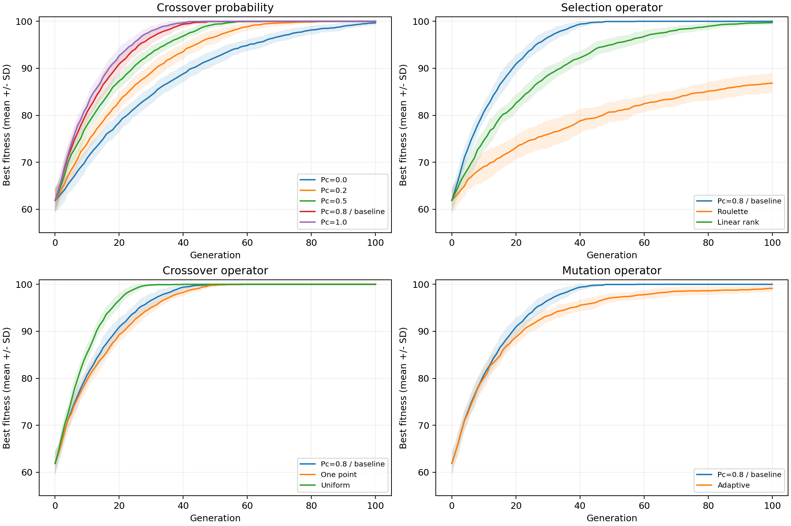
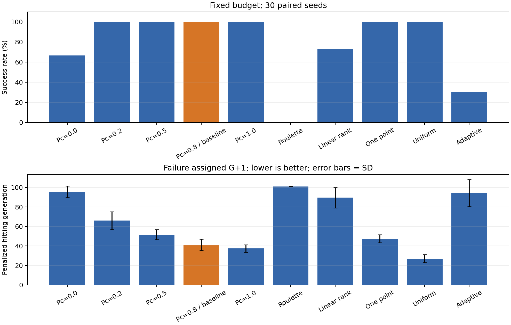
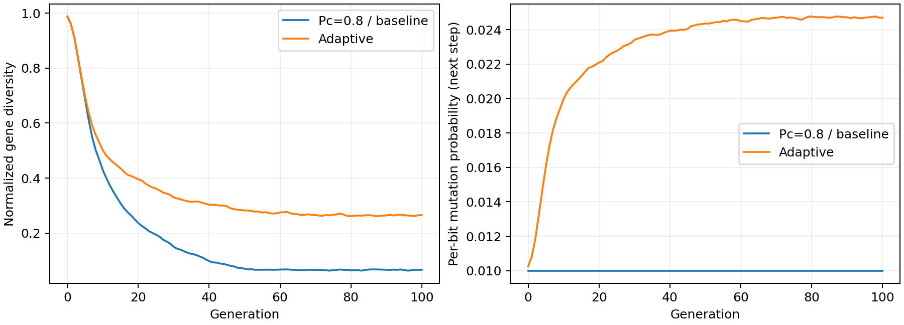

# 遗传算法代码实践小组实验报告

## 一、实验目的与代码来源

本实验运行公开遗传算法示例，理解初始化、适应度评价、选择、交叉、变异和代际更新流程，再在统一代码和测试问题下，采用单因素对照研究交叉概率与不同算子的作用。

原始代码选自DEAP官方`examples/ga/onemax_short.py`，已保存未修改副本及许可证。本次另外编写NumPy版统一实验代码，显式实现八种算子、精英保留及多种子统计。原版仅用于来源复现，受控实验全部使用同一个扩展实现；不能将两套默认配置直接当作算子对照。

固定源代码提交：`8a96fd3a75026f7b30e835f595a5199c75634ddf`。
原版源码及许可证随作业提交，位于vendor目录。下文直接定义测试问题、算法、算子和统计指标。

## 二、统一测试问题与基本流程

### 2.1 OneMax问题的完整定义

OneMax是一个二进制优化问题：在长度固定的0/1串中，让数字1的数量尽可能多。设串长为n，一个候选解记为x=(x₁,x₂,…,xₙ)，每个xᵢ只能取0或1；所有这样的串均为合法解，没有额外约束。目标函数定义为：

```text
最大化 f(x) = x₁ + x₂ + … + xₙ
约束：xᵢ ∈ {0,1}，i=1,…,n
```

例如，n=8时，x=10110010中有4个1，因此f(x)=4；将其中一个0改为1后，适应度变为5。最优解为11111111，最优值为8。

本实验固定n=100，搜索空间共有2¹⁰⁰个不同的二进制串，适应度为0到100之间的整数。唯一全局最优解是100个1组成的串，最优值为100；含99个1的串得99分。只要串中还有0，就能通过翻转该位使目标值增加1，因此在单个位翻转的邻域下，不存在最优解以外的局部极大值。各位的贡献独立，每个1都贡献1分。

选择该问题是因为最优值已知，便于核验算法是否成功，并在统一条件下比较收敛速度。实验仍从随机种群出发执行完整遗传算法，记录发现最优解的过程。该问题不能代表复杂约束、位点相互依赖或存在多个局部极大值的问题。

### 2.2 遗传算法的基本概念

遗传算法（Genetic Algorithm，GA）是一种维护多个候选解、反复筛选并产生新解的随机搜索方法。本实验使用以下定义：

| 概念 | 在本实验中的含义 |
| --- | --- |
| 个体／染色体 | 一个长度100的二进制串，代表一个候选解 |
| 基因／位点 | 串中的一个位置及其0或1取值；等位基因指该位置可能取的值 |
| 种群 | 同一代的N个候选解，本实验N=80 |
| 适应度 | 候选解的评分，直接取OneMax目标函数f(x)，越大越好 |
| 代 | 一轮种群更新；随机初始种群记为第0代，更新后为第1代，依此类推 |
| 遗传算子 | 选择父本、重组父本或改变基因的规则，分别称为选择、交叉、变异 |
| 精英保留 | 将上一代适应度最高的1个个体原样放入下一代，避免当前最好解丢失 |
| 收敛速度 | 本报告用首次发现最优解的代数衡量，代数越少表示越快 |

选择压力指选择规则偏向高适应度个体的程度；压力较强通常会加快优良个体扩散，也可能使种群更快失去不同基因取值。种群多样性指个体在各位取值上的差异，具体指标在4.3节定义。

### 2.3 本实验的迭代流程

```text
随机初始化80个染色体 → 计算适应度
  ↓
选择80个父本 → 两两按Pc交叉 → 按位变异 → 用上一代精英替换1个子代
  ↓
评价新一代 → 记录最优值、平均值、多样性、是否首次达到100
  ↓
固定运行100代（达到100也继续）→ 汇总30个种子的统计结果
```

交叉概率Pc定义为一对父本执行交叉的概率。Pc=0.8表示每对父本有80%的概率执行交叉；80个父本配成40对时，平均约32对触发交叉，但每代实际数量可以波动。未触发时先复制父本，仍可继续发生变异。均匀交叉触发后，各位另以0.5概率交换。

变异概率Pm定义为一个子代的某一位翻转的概率，翻转即0变1或1变0。基本变异的Pm=0.01意味着100位个体平均翻转1位，实际可以为0位或多位。本扩展实现对各位独立变异，没有再套一层个体变异概率；随后用未变异的精英替换一个子代。

## 三、原始代码运行结果

原始示例固定seed=64、种群300、100位、运行40代；采用三元锦标赛、两点交叉，Pc=0.5，个体变异概率0.2，触发变异后每位翻转概率0.05；HallOfFame只保存历史最优，不自动把精英注入种群。

实际运行的历史最优值为 **100/100**；末代最大值为100，末代平均值为98.833。完整40代输出与最优串已记录。以下参数实验使用统一扩展基准，保持各对照组预算一致。

## 四、受控实验设计与算子任务

### 4.1 统一设置与公平比较

| 项目 | 统一设置 |
| --- | --- |
| 染色体与目标 | 100位二进制；最大化1的个数，最优100 |
| 种群与迭代 | 80个体、100代，全部运行固定预算 |
| 基准组合 | Pc=0.8、三元锦标赛、两点交叉、基本变异 |
| 变异与精英 | 基本逐位Pm=0.01；每代保留1个精英，不参与变异 |
| 重复与种子 | 每配置30次，种子20261023至20261052 |
| 评价预算 | 初代及每代均评价80个体，每次8080次OneMax评价 |

不同配置对相同种子使用完全相同初始种群，并保存SHA256进行核对。初始化、选择、交叉和变异采用四条独立随机数流；算法变化后后续种群会不同，相同种子并不意味着所有后续随机事件完全一致。所有组均不提前停止。随机种子是初始化伪随机数生成器的整数，用于重复同一随机实验；SHA256是从数据计算的固定长度校验值，此处用于核对初始种群文件内容是否一致。

### 4.2 算子任务划分

算子实验按以下任务编号组织，组长可按实际人数分配，成员选择的任务编号不重复。

| 任务编号 | 算子 | 本次实现 |
| --- | --- | --- |
| S1 | 轮盘赌选择 | 按非负适应度占比采样，全零时均匀采样 |
| S2 | 锦标赛选择 | 随机抽3个候选，取适应度最高者；允许重复抽样 |
| S3 | 排序选择 | 线性排序，选择压力s=1.7，同适应度使用平均秩 |
| C1 | 单点交叉 | 选一个内部断点，交换后缀 |
| C2 | 两点交叉 | 选两个不同内部断点，交换中段 |
| C3 | 均匀交叉 | 触发交叉后，每位以0.5概率交换 |
| M1 | 基本变异 | 每位固定Pm=0.01独立翻转 |
| M2 | 自适应变异 | 根据上一代多样性调整逐位Pm，公式如下 |

### 4.3 八种算子的具体定义

**选择算子。** 每代从当前种群有放回地选出80个父本，同一个个体可以被选多次。记第i个个体的适应度为fᵢ，种群规模为N。

1. 轮盘赌选择：每次选中个体i的概率为qᵢ=fᵢ/Σfₖ。例如适应度为2、3、5时，选择概率分别为0.2、0.3、0.5；全部为0时，各个体概率均为1/N。
2. 三元锦标赛选择：每次均匀随机抽取3个候选，允许重复抽取，从中选择适应度最高者。最高分并列时取本次抽样中先出现的候选。重复80次形成父本集合。
3. 线性排序选择：按适应度从低到高赋予秩rᵢ，最差为1、最好为N，同分者使用所占名次的平均值。例如排序后的适应度为1、2、2、4时，秩为1、2.5、2.5、4。定义qᵢ=(2−s)/N+2(rᵢ−1)(s−1)/[N(N−1)]，本实验s=1.7。s在[1,2]内控制选择压力，s=1时均匀选择；无并列时最好者和最差者的概率分别为s/N和(2−s)/N。

**交叉算子。** 对每一对父本先按Pc决定是否交叉，触发后产生两个互补交换的子代。下述断点k表示前k位之后的位置，内部断点从1至n−1中均匀抽取。

1. 单点交叉：抽取一个内部断点，交换断点后的全部位。例如父本1111|0000和0000|1111在第4位后交换，得到11111111和00000000。
2. 两点交叉：抽取两个不同内部断点a<b，交换第a+1至第b位，其他位置保持。例如父本11|1100|00和00|0011|11在第2、6位后切开，交换中段得到11001100和00110011。
3. 均匀交叉：对每个位点独立产生一个交换决定，概率为0.5；决定交换时，两子代在该位互换父本取值，否则各自保留对应父本取值。因此一次交叉可以在多个分散位置交换。

**变异算子。** 交叉后对子代的每一位独立作翻转决定，基本变异固定Pm=1/n=0.01。自适应变异则根据当前种群的多样性，为下一代生成过程计算Pm。记xᵢⱼ为第i个个体在第j位的0/1取值，第j位取1的比例为pⱼ=(Σᵢxᵢⱼ)/N，定义：

```text
D = [Σⱼ 4pⱼ(1−pⱼ)] / n
自适应Pm = 0.01 + 0.02(1−D)
```

这里求和遍历全部n个位点，D是各位差异程度的平均值，范围为[0,1]。当所有个体完全相同时，每位pⱼ均为0或1，D=0；当每位恰有一半个体取1时，D=1。因此自适应Pm范围为[0.01,0.03]，D=1时取0.01，D=0时取0.03，多样性下降时增加扰动。这是本作业定义的一种自适应规则，不代表所有自适应变异，也不保证更优。

### 4.4 单因素对照方案

交叉概率取0、0.2、0.5、0.8、1.0，其余用基准设置。选择、交叉、变异算子对照分别只替换对应算子，其余保持Pc=0.8与基准配置。基准被多张表复用，共10种唯一配置，而非重复运行并挑选有利结果。

## 五、结果与指标

每次运行把某一代种群中最大的f(x)记为该代最优适应度，末代最优值为第100代的该值。成功指第0至100代中至少一次出现f(x)=100，成功率为成功次数除以30。成功代数指首次出现100的代数，其均值只对成功运行计算；没有成功运行时用‘—’表示。

终值及惩罚代数均报告30次运行的均值±样本标准差（SD）。对于30个观测值yᵢ，均值ȳ=(Σyᵢ)/30，SD=√[Σ(yᵢ−ȳ)²/29]；SD越大表示不同种子的结果波动越大，表中的‘±’表示离散程度，不表示结果必定落在该范围内。

为计入未成功的运行，定义惩罚到达代数：成功取首次成功代数，未成功取预算上限100再加1，即101，越小越好。例如两次运行分别在第40代成功、100代内未成功，其惩罚代数均值为(40+101)/2=70.5。它是人为定义的预算惩罚指标，不是真实的无条件期望收敛时间。

### 5.1 交叉概率对照

| 配置 | 末代最优均值±SD | 成功次数 | 成功代数均值 | 惩罚代数均值±SD |
| --- | --- | --- | --- | --- |
| Pc=0.0 | 99.67±0.48 | 20/30 | 92.80 | 95.53±5.84 |
| Pc=0.2 | 100.00±0.00 | 30/30 | 65.97 | 65.97±9.10 |
| Pc=0.5 | 100.00±0.00 | 30/30 | 51.57 | 51.57±5.16 |
| 基准：Pc=0.8 | 100.00±0.00 | 30/30 | 41.23 | 41.23±5.78 |
| Pc=1.0 | 100.00±0.00 | 30/30 | 37.43 | 37.43±3.86 |

### 5.2 选择算子对照

| 配置 | 末代最优均值±SD | 成功次数 | 成功代数均值 | 惩罚代数均值±SD |
| --- | --- | --- | --- | --- |
| 锦标赛选择（基准） | 100.00±0.00 | 30/30 | 41.23 | 41.23±5.78 |
| 轮盘赌选择 | 86.83±2.10 | 0/30 | — | 101.00±0.00 |
| 线性排序选择 | 99.73±0.45 | 22/30 | 85.27 | 89.47±10.43 |

### 5.3 交叉算子对照

| 配置 | 末代最优均值±SD | 成功次数 | 成功代数均值 | 惩罚代数均值±SD |
| --- | --- | --- | --- | --- |
| 两点交叉（基准） | 100.00±0.00 | 30/30 | 41.23 | 41.23±5.78 |
| 单点交叉 | 100.00±0.00 | 30/30 | 47.37 | 47.37±4.00 |
| 均匀交叉 | 100.00±0.00 | 30/30 | 27.03 | 27.03±4.13 |

### 5.4 变异算子对照

| 配置 | 末代最优均值±SD | 成功次数 | 成功代数均值 | 惩罚代数均值±SD |
| --- | --- | --- | --- | --- |
| 基本变异（基准） | 100.00±0.00 | 30/30 | 41.23 | 41.23±5.78 |
| 自适应变异 | 99.13±0.68 | 9/30 | 78.22 | 94.17±13.93 |



图1：曲线为多次运行的最优适应度均值，阴影为±1个样本标准差，不是置信区间。



图2：固定预算下的成功率和惩罚到达代数；误差棒为样本标准差。



图3：基准与自适应变异的平均多样性和逐位变异概率；第100代概率是按末代状态计算，未继续执行。

### 5.5 同种子配对差异

对每个种子计算‘该配置惩罚代数−基准惩罚代数’，负数表示更快。bootstrap在这里指有放回重采样：每次从30个种子的配对差值中随机抽30个，计算其均值，重复10000次，固定统计种子314159。将这10000个均值排序，取2.5%和97.5%分位数作为百分位95%区间。这些区间用于探索性描述，未做多重比较校正；区间跨0时不据均值排序断言谁更优。

| 配置 | 配对均值差/代 | bootstrap 95%区间 |
| --- | --- | --- |
| Pc=0.0 | 54.30 | [51.70, 56.83] |
| Pc=0.2 | 24.73 | [21.27, 28.53] |
| Pc=0.5 | 10.33 | [7.90, 13.07] |
| Pc=1.0 | -3.80 | [-6.20, -1.40] |
| 轮盘赌选择 | 59.77 | [57.70, 61.77] |
| 线性排序选择 | 48.23 | [43.97, 52.33] |
| 单点交叉 | 6.13 | [3.47, 8.67] |
| 均匀交叉 | -14.20 | [-16.60, -11.67] |
| 自适应变异 | 52.93 | [47.17, 58.00] |

## 六、分析、发现的问题与结论

**交叉概率。** 本次Pc组中，Pc=1.0的惩罚代数均值最低，为37.43。交叉可以组合不同个体中已有的有利位点，但不会凭空产生缺失的等位基因；Pc=0仍可通过选择和变异改进。较大Pc也会打散已有组合，不能仅凭参数大小判断结果，更不能把本次最佳值称为普遍最优Pc。

**选择算子。** 基准锦标赛成功30/30，轮盘赌0/30，排序选择22/30。在OneMax后期，大多数个体的适应度接近，轮盘赌的相对权重差缩小，选择压力可能不足；锦标赛保持较强筛选，线性排序通过秩控制压力。这是具体压力参数的对照，不能证明任意锦标赛都优于排序选择。

**交叉算子。** 本次交叉组中均匀交叉的惩罚代数均值最低。单点与两点交叉保留连续片段，均匀交叉更细粒度重组位点。OneMax各位贡献独立，不存在必须保持的相邻联动结构，因而这种结果不能直接推广到位点间依赖很强的问题。

**变异算子。** 自适应组成功9/30，惩罚代数均值94.17，基准为41.23。提高变异率能补充多样性，但在接近全1时也会把更多有利位点翻回0。本规则只根据多样性提高Pm，没有根据距离最优的程度减小扰动；自适应并不等于性能必然提高。

**指标选择问题。** 多组实验末代最优值可能同为100，单看终值会掩盖收敛速度差异；只统计成功代数又会忽略失败，因此同时报告成功率、成功代数和带失败惩罚的指标。

**可比性与局限。** 全部组共享初始种群、预算、精英数和单一目标函数。运行耗时另存于CSV，但NumPy向量化程度和算子实现开销不同，本文不把单次墙钟时间当作算法理论复杂度。30个种子只能支持当前问题和预算下的经验结论，未测试算子组合交互、复杂约束问题或多峰函数。

本次实践验证了GA的完整流程，并完成5个Pc取值、3种选择、3种交叉和2种变异的单因素对照。最终结果表明应结合选择压力、重组方式、变异强度和多样性理解性能，避免只报告一次最优运行。

